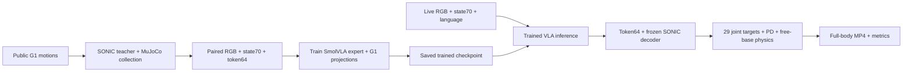

# Robot Foundry — train VLA toàn thân G1 trên Kaggle

Project hiện ưu tiên **G1 đi bộ/cử động toàn thân**: sinh demonstration đồng bộ trong MuJoCo, fine-tune SmolVLA rồi dùng checkpoint đã train dự đoán token cho SONIC điều khiển 29 DOF. Nhánh Panda/LIBERO gắp vật được giữ riêng. Mã nguồn theo cấu trúc Python `src/`, `pyproject.toml`, JSON configs, provenance/checksums và kiểm thử; project chưa có chứng nhận ISO hay kiểm định robot thực.

**Repo public:** [TrgPhan/robot-vla-foundry](https://github.com/TrgPhan/robot-vla-foundry). Import [`notebooks/kaggle_g1_train.ipynb`](notebooks/kaggle_g1_train.ipynb) vào Kaggle, bật Internet + **GPU T4 ×2**. [`kaggle_train.ipynb`](notebooks/kaggle_train.ipynb) là bản giống hệt; notebook clone tag **`g1-vla-v1`**, không cần GitHub token. Hướng dẫn: [`docs/KAGGLE.md`](docs/KAGGLE.md).

## Pipeline G1 hiện tại



1. Collector chạy controller/physics thật, chụp RGB và state trước action; teacher encoder tạo nhãn token64. Stats chỉ từ train, split theo cả episode/scenario.
2. SmolVLA giữ VLM frozen, train action expert và ba projections mới cho state70 padded96/action64. SONIC frozen làm controller/prior; không ghép action Panda vào chân G1 hoặc tạo balance loss từ data không có chân.
3. Learned runner yêu cầu checkpoint có optimizer update thành công và đúng controller/data identity. Sau pose initialization, VLA dùng ảnh/state/lệnh hiện tại; token dự đoán điều khiển SONIC decoder. Reference chỉ dùng chấm metric, không dùng teacher fallback.
4. Benchmark nội bộ so motion tracking/survival của learned VLA với train-mean token baseline trên cùng held-out scenario seeds. Source primitives vẫn giống train; không gọi đây là unseen-task generalization.

Chi tiết schema/cơ chế: [`docs/G1_TRAINING.md`](docs/G1_TRAINING.md). Tác vụ hiện là walk/turn và macarena; tay/chân/thân đều có joint targets, **ngón tay là mesh cố định, chưa gắp vật**. Muốn pickup/carrying cần paired G1 object-interaction data, scene và hand controller phù hợp.

## Chạy Kaggle T4 ×2

- Bắt đầu `SMOKE=True`, `MICROBATCH=1`, `WORKERS=2`, `GPUS='auto'`. Collector chuẩn bị dữ liệu; bước train sau đó chạy 20 optimizer updates thật.
- Sau smoke, đổi `SMOKE=False` để train 5.000 bước với tên run `full`. Full effective batch **16 = 2 GPU × microbatch1 × accumulation8**, FP16/GradScaler/DDP; DDP không cộng VRAM hai GPU.
- Default dataset có hai primitive, mỗi primitive 8 train/2 val/2 test episodes, 256 px/H20. Collection có resume và checksums. Thêm nhiều bản cùng clip không tạo thêm kỹ năng mới.
- Sau training, notebook nạp `outputs/RUN_NAME/best`, chạy learned full-body simulation và baseline, hiển thị MP4. Infer lỗi được ghi riêng và giữ artifacts train.
- Giữ checkpoint, `training_state.pt`, prepared data và eval outputs. Cần 6 GiB disk dự phòng sau model staging; export atomic, không tạo ZIP nhân đôi weights mặc định. Resume giữ nguyên config/data/world size.

VRAM/throughput và chất lượng của full recipe chưa được đo trên Kaggle. Microbatch2 chỉ tăng sau smoke mới xác nhận đủ VRAM. Hướng dẫn chạy/resume/disk: [`docs/KAGGLE.md`](docs/KAGGLE.md).

## Đã kiểm chứng

| Kiểm chứng | Kết quả thực đo local |
|---|---|
| G1 SmolVLA optimizer | 2 CUDA FP16 updates, 0 AMP skips; 99.988.544 trainable parameters |
| G1 checkpoint save/reload | State70, action chunk `[16,64]`; giữ head đã train |
| Diagnostic peak VRAM | 3.141 MiB ở 96 px/H16, batch1; không đại diện recipe 256 px/H20 |
| Learned G1 full-body inference | 2 held-out scenarios ×3 giây, 29 DOF/free-base; measured teacher calls sau initialization =0 |
| Motion tracking smoke | Learned 2/2, mean-token baseline cũng 2/2; chưa chứng minh learning gain |
| Raw data export | Fixed-size `float32[70]` state / `float32[64]` action; 120 frames kiểm tra schema |
| Python regression suite | 49 tests pass local |

Xem [`reports/g1_vla_integration.json`](reports/g1_vla_integration.json). Hai optimizer updates là kiểm chứng tích hợp, chưa phải convergence; latent test RMSE của diagnostic cũng chưa vượt mean-action baseline. Full 5.000-step run chưa hoàn tất ở đây. Checkpoint/results riêng tải từ Kaggle được giữ trong `outputs/`, không đưa vào source release.

## Chạy local và các nhánh khác

Các lệnh G1 sau khi cài môi trường được ghi tại [`docs/G1_TRAINING.md`](docs/G1_TRAINING.md). Production SmolVLA guard >=14 GiB/GPU; RTX A1000 4 GB chỉ chạy diagnostic <=2 bước ở 96 px/H16 hoặc baseline TinyBC. TinyBC là model nhỏ train từ đầu, không phải foundation VLA.

Demo SONIC reference CPU riêng dùng `python scripts/setup_fullbody_sim.py`, rồi `.venv-fullbody/Scripts/python.exe scripts/run_fullbody_sim.py`. Demo này chỉ kiểm tra controller; learned checkpoint phải dùng `scripts/run_g1_vla_sim.py`. Xem [`docs/FULLBODY.md`](docs/FULLBODY.md).

Nhánh **Panda/LIBERO** còn [`kaggle_panda_train.ipynb`](notebooks/kaggle_panda_train.ipynb), [`docs/KAGGLE_PANDA.md`](docs/KAGGLE_PANDA.md), [`docs/LOCAL_SIM.md`](docs/LOCAL_SIM.md). Checkpoint Panda OSC7 không được dùng điều khiển G1. Historical TinyBC/SmolVLA/DDP smoke nằm trong `reports/`; RMSE không thay thế closed-loop task success.

**GR00T N1.7** và G1 manipulation native64+7+7 vẫn có launcher Linux/GPU lớn ở `configs/groot_libero.json`/`configs/groot_g1.json`. SmolVLA G1 adapter là code riêng của project, không gọi là GR00T/π₀.₅. SONIC điều khiển toàn thân, không chỉ chân; thiết kế và benchmark ở [`docs/DESIGN.md`](docs/DESIGN.md), [`docs/BENCHMARK.md`](docs/BENCHMARK.md).

## Cấu trúc và nguồn

```text
configs/       data/model revision locks và training recipes
src/robot_foundry/
               collectors, schema, training, checkpoints, inference, simulation
scripts/       setup, notebook generation, train/eval entrypoints, packaging
notebooks/     G1 primary notebook và Panda alternative
tests/         split/padding, optimizer/resume/DDP, transport, G1 control
docs/          cơ chế, data catalogue, benchmark và hướng dẫn
reports/       validation thực đo công khai
data/          raw/prepared/assets — không đưa vào Git
outputs/       checkpoints, videos, experiment logs — không đưa vào Git
vendor/        pinned upstream repositories — bootstrap riêng
```

Nguồn G1: [NVIDIA motion clips](https://github.com/NVlabs/GR00T-WholeBodyControl/tree/b042411fae38ee4d1af9aac82a37a1f8d14d6dd0/gear_sonic_deploy/reference/example), [SONIC v1.1](https://huggingface.co/nvidia/GEAR-SONIC/tree/6733128a3d8a523b1418b06bca3cdf61c8b0987f/sonic_v1_1), [SmolVLA pretrained](https://huggingface.co/lerobot/smolvla_base). Dữ liệu task là simulation-generated từ các nguồn đó, không phải teleop G1 thật. Catalogue dataset Panda và nguồn bổ sung: [`docs/DATASETS.md`](docs/DATASETS.md).

Mã mới theo MIT; upstream, pretrained weights và datasets giữ license từng nguồn. Source archive không đóng gói datasets/model NVIDIA. Registry giữ `null` nếu dataset card không công bố license.
