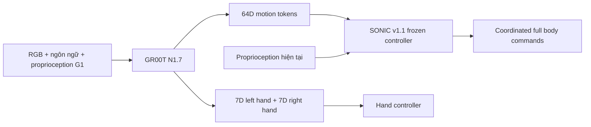

# Review ý tưởng và phương án cuối cùng

Ngày khảo sát ban đầu: 12/10/2026; cập nhật nhánh G1 motion: 14/10/2026. Bạn chưa có robot/dữ liệu G1 và chọn ưu tiên train đi bộ/cử động toàn thân bằng simulation trên Kaggle.

## Phần hợp lý trong ý tưởng

VLA phù hợp với mục tiêu điều khiển có ngôn ngữ và hình ảnh. Tách policy tác vụ khỏi controller vận động có thể giúp giảm không gian học, giữ kỹ năng nền và tránh phải học lại cân bằng từ vài demonstration. Public LeRobot data là điểm khởi đầu tốt cho quản lý dữ liệu đồng bộ.

## Điều cần chỉnh

SONIC là policy/controller toàn thân được học bằng motion tracking, không phải một regularizer dạng loss tự có thể ghép vào mọi VLA. Controller nhận proprioception và biểu diễn chuyển động riêng; torque/PD targets và chuyển động thân trên ảnh hưởng đến cân bằng chân. Hai policy độc lập ghi đè cùng joint hoặc dùng frame/FPS khác nhau dễ xung đột.

Ở G1, chọn giao diện đã có của NVIDIA: VLA dự đoán token SONIC và điều khiển bàn tay; SONIC xử lý toàn thân. Dùng cùng controller variant và cùng token space giữa thu thập, train và inference. Controller chạy 50 Hz; reference VLA trả chunk 40 token/step, không yêu cầu model phải gọi 50 lần/giây. [Workflow](https://nvlabs.github.io/GR00T-WholeBodyControl/tutorials/vla_workflow.html).



Trong giai đoạn đầu **không thêm balance loss giả** từ dữ liệu Panda. Cách prior có tác dụng là giới hạn action ở biểu diễn SONIC và giữ controller đã học. Nếu muốn regularizer tường minh, cần differentiable surrogate/rollout có G1 dynamics, base pose, contacts, torque và object load; sau đó mới thử penalize tilt, foot slip, saturation, support margin. Proxy như CoM nằm trong support polygon không đủ để chứng minh dynamic stability.

## Lựa chọn giữa π và GR00T

Hiểu “psi” là họ π₀/π₀.₅ của Physical Intelligence. [OpenPI chính thức](https://github.com/Physical-Intelligence/openpi) là phương án mạnh cho manipulation, nhưng cần post-training trên đúng embodiment và không cung cấp mặc nhiên cùng giao diện SONIC native. Vì mục tiêu lâu dài là SONIC/G1, chọn GR00T N1.7 cho hướng chính. Nhánh SmolVLA giúp có thí nghiệm khả thi trên GPU nhỏ; không được dùng kết quả của nó để đại diện GR00T.

## Hai giai đoạn có thể đánh giá độc lập

**A — manipulation công khai:** task gắp vật vào giỏ; Panda; train LIBERO Object, supplement Spatial. Đánh giá closed-loop với LIBERO. LeRobot SO100 và GR1 simulation được khảo sát nhưng không trộn vào Panda recipe. MuJoCo có thể chạy trên máy hiện tại cho baseline.

**B — humanoid tương tác:** chọn G1, SONIC v1.1 frozen. Ghi/giả lập 50–100 demonstration thành công với cùng camera, tay, payload và controller; split theo session/object trước khi train. Phải có cả thao tác vật, RGB, state, token và hand labels. Dữ liệu motion không có object dynamics không kiểm chứng được pickup/carrying.

**B0 — humanoid motion trước:** hiện có collector tạo paired RGB/state70/token64 bằng SONIC/MuJoCo và trainer SmolVLA G1 trên T4 ×2. Learned runner nạp checkpoint đó, đưa token dự đoán vào decoder để điều khiển 29 DOF. Local đã chạy optimizer/save/reload/control; chất lượng hội tụ và gắp vật chưa được chứng minh. [`G1_TRAINING.md`](G1_TRAINING.md) mô tả implementation.

B vẫn cần paired manipulation data/hand controller; motion B0 không được đánh giá thành pickup/carrying. Nhánh SmolVLA này hỗ trợ phần cứng Kaggle, không gọi là GR00T.

## Code cho hướng SONIC

Nhánh **SONIC v1.1 ONNX + MuJoCo** hiện chạy được trên Windows/Linux CPU, với G1 free-base 29 DOF và video toàn thân. Hướng dẫn setup/inference, phạm vi controller và dữ liệu cần cho VLA ở [`FULLBODY.md`](FULLBODY.md). Motion reference demo này chưa chạy frontend VLA hoặc object manipulation.

Bootstrap và tạo plan cho training/evaluation Isaac Lab; launcher `sonic_plan.py --run` cần môi trường Isaac Lab riêng. [Training guide](https://nvlabs.github.io/GR00T-WholeBodyControl/user_guide/training.html).

```bash
python -m robot_foundry.cli bootstrap --repos sonic
python scripts/sonic_plan.py --motion-dir data/g1_motion_holdout --mode eval
```

`--run` thực thi trong Python đã cài SONIC/Isaac Lab; mặc định chỉ in plan. Motion đầu vào là PKL đã convert/filter bằng công cụ upstream. Không tự tải toàn bộ BONES-SEED: repository yêu cầu chấp nhận điều khoản, dữ liệu lớn và phải chọn motion phù hợp. Nếu finetune controller, dùng `--mode finetune --smpl-motion-dir ...` với G1/SMPL đồng bộ. Không retrain SONIC từ đầu trong Kaggle notebook này.

Trước khi fine-tune VLA G1:

```bash
python -m robot_foundry.cli validate-g1 --dataset data/g1_sonic/cleaned_train
python -m robot_foundry.cli train-groot --config configs/groot_g1.json --dry-run
```

Validator yêu cầu các modality G1, ego camera, 50 Hz, motion token 64 chiều, hai tay 7 chiều, các vector hữu hạn và số frame khớp metadata. Thêm `meta/sonic_provenance.json` từ controller thực sự dùng khi thu thập:

```json
{
  "controller_variant": "sonic_v1_1",
  "controller_sha256": "DIGEST_SHA256_64_KY_TU_CUA_CONTROLLER_THAT"
}
```

Điền digest thật, không giữ chuỗi minh họa. Validator không thể chứng minh annotation đúng ngữ nghĩa chỉ bằng kích thước; replay/visual review là bước bắt buộc trước experiment G1.

## Cải thiện performance và độ ổn định

Ưu tiên nhiều demonstration sạch trên cùng camera/action convention, rồi mới thêm task. Chạy ablation Object-only so với Object+Spatial; dữ liệu bổ sung có thể gây negative transfer. Freeze backbone trước, sweep LR `3e-5`, `1e-4`, `3e-4` trên validation; có tài nguyên mới thử unfreeze một phần. Dùng ít nhất 3 seed ở run chính, giữ test cuối cùng độc lập với lựa chọn hyperparameter.

Measure latency p50/p95, execution horizon, camera staleness và action limits cùng success. Humanoid cần thử stand/reach, payload, disturbance và locomotion theo mức tăng dần trong simulation; giữ joint order/frame conventions và controller identity cố định. Các threshold và object physics phải được công bố trước test, không chỉnh để tạo một success rate đẹp.

Tất cả đề xuất cải thiện trên là kế hoạch experiment; chưa có evidence để cam kết success rate hay “performance tốt nhất”.
