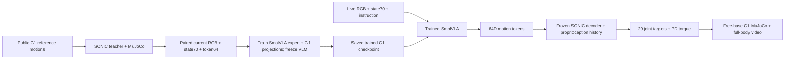

# Train VLA toàn thân G1 rồi infer checkpoint đã train

Notebook chính [`notebooks/kaggle_train.ipynb`](../notebooks/kaggle_train.ipynb) và bản có tên rõ [`kaggle_g1_train.ipynb`](../notebooks/kaggle_g1_train.ipynb) hiện chạy **data collection → optimizer training → checkpoint inference → MuJoCo full-body video**. Notebook Panda cũ nằm riêng ở [`kaggle_panda_train.ipynb`](../notebooks/kaggle_panda_train.ipynb). `scripts/run_fullbody_sim.py` vẫn là demo SONIC reference, không phải notebook train mới.

Tác vụ của nhánh train này: G1 đi bộ/quay theo motion và thực hiện động tác macarena qua lệnh ngôn ngữ. Nó điều khiển cả 29 khớp thân/chân/tay; bàn tay là mesh cố định, chưa có gắp vật hoặc Dex3 finger control. Dữ liệu là demonstration **sinh bằng simulation** từ nguồn motion công khai, không được gọi là teleop G1 thật.



## Nguồn và dữ liệu

- SmolVLA pretrained: [lerobot/smolvla_base](https://huggingface.co/lerobot/smolvla_base), revision trong `configs/datasets.json`.
- SONIC v1.1 encoder/decoder: [nvidia/GEAR-SONIC](https://huggingface.co/nvidia/GEAR-SONIC/tree/6733128a3d8a523b1418b06bca3cdf61c8b0987f/sonic_v1_1).
- Motion [walking_quip](https://github.com/NVlabs/GR00T-WholeBodyControl/tree/b042411fae38ee4d1af9aac82a37a1f8d14d6dd0/gear_sonic_deploy/reference/example/walking_quip_360_R_002__A428) và [macarena](https://github.com/NVlabs/GR00T-WholeBodyControl/tree/b042411fae38ee4d1af9aac82a37a1f8d14d6dd0/gear_sonic_deploy/reference/example/macarena_001__A545), cùng meshes/XML đúng commit lock.

`g1_collect.py` chạy decoder/PD/dynamics thật, chụp ảnh và state **trước action**, ghi token teacher đúng cùng timestep 50 Hz. Future reference chỉ tạo nhãn teacher; không nằm trong input VLA. Raw export theo layout LeRobot v2.1 dùng parquet state/action `float32`, timestamp/index và video H264. Train dùng packed PNG lossless; raw video là bản export/preview có nén. Split của project nằm trong manifest và episode metadata; không train toàn bộ raw directory mà bỏ qua split.

Default: 2 motion primitives, mỗi primitive 8 train + 2 val + 2 test rollout seeds, tối đa 455 frame/episode (9,1 giây), initialization 0,5 giây. Macarena dài hơn nên đây là window đầu 9,1 giây. Camera/yaw/initial joints được thay đổi theo seed. Test giữ nguyên primitive nguồn và đổi scenario; **không phải generalization sang motion/task mới**. Muốn tăng độ đa dạng, thêm primitive đã kiểm tra teacher/physics và tăng số scenario; không coi nhiều bản cùng clip là nhiều kỹ năng mới.

Stats chỉ dùng full-frame train episodes; không tính từ holdout/padded chunks. Stride 2 giảm sample ảnh; action chunk vẫn gồm timestep liên tục 50 Hz. Raw files, packed files, stats và encoder/decoder identity có checksum. Collection có state để tiếp tục sau ngắt, từ chối config thay đổi hoặc artifact hỏng. Teacher fall dừng và ghi failure, không bị đổi thành demonstration thành công.

## Train thật và thay đổi architecture

State 70D: 29 joint position + 29 joint velocity (Isaac order), angular velocity 3D, gravity 3D, base linear velocity 3D, pelvis height và heading sin/cos. Output 64D là token SONIC, không phải Panda OSC 7D. Inference kiểm tra state vật lý, action layout và đúng hash controller.

SmolVLA base có capacity state/action 32D. Code giữ VLM/action expert pretrained, **khởi tạo lại** `state_proj`, `action_in_proj`, `action_out_proj` cho state70 padded96/action64. Không gán ý nghĩa token SONIC cho output tay cũ. Export lưu config mới và `policy_boundary_adaptation.json`; reload giữ đúng tensor shapes, không khởi tạo lại head đã train.

VLM frozen; action expert và state/action projections được optimizer cập nhật. SONIC ONNX frozen làm controller/prior toàn thân. Đây là huấn luyện policy tác vụ toàn thân qua latent space; không retrain SONIC/RL, không thêm balance loss giả từ Panda. [Giao diện latent VLA/SONIC của NVIDIA](https://nvlabs.github.io/GR00T-WholeBodyControl/tutorials/vla_workflow.html) là cơ sở kiến trúc; SmolVLA G1 motion adapter này là implementation riêng của project, không phải checkpoint GR00T hoặc kết quả NVIDIA công bố.

T4 ×2: một process/GPU, FP16 autocast/GradScaler, FP32 master weights, batch16 = 2 × microbatch1 × accumulation8. `SMOKE=True` chạy 20 optimizer steps; `False` chạy 5.000. Có guard >=14 GiB/GPU và 6 GiB disk reserve, transactional model/optimizer export, resume cùng config/data/world size. Microbatch2 chỉ dùng sau smoke đo VRAM thực tế.

```bash
# Đã có môi trường VLA và .venv-fullbody; chạy từ root repo.
.venv-fullbody/bin/python scripts/collect_g1_data.py --config configs/g1_data.json
VLA_PY scripts/run_g1_train.py --mode smoke --name g1_smolvla_smoke --gpus 2
VLA_PY scripts/run_g1_train.py --mode full --name g1_smolvla_full --gpus 2
VLA_PY scripts/run_g1_vla_sim.py --run g1_smolvla_full --skip-setup --trials 2
VLA_PY scripts/run_g1_vla_sim.py --run g1_smolvla_full --skip-setup --trials 2 --policy-mode mean_token --output outputs/g1_mean_baseline
```

Thay `VLA_PY` bằng Python môi trường train; Windows dùng `.venv-fullbody/Scripts/python.exe` cho collector. Setup VLA theo `LOCAL_SIM.md`, setup simulator bằng `python scripts/setup_fullbody_sim.py`. RTX A1000 4 GB chỉ được kiểm tra diagnostic SmolVLA <=2 steps, 96 px/H16, batch1; guard production không bị hạ. TinyBC là lựa chọn train baseline nhỏ, không phải foundation VLA.

## Infer và benchmark

`G1Predictor` yêu cầu report có optimizer update thành công, backend/action64/data fingerprint phù hợp và weights đã lưu. `run_g1_vla_sim.py` mở policy server do nó sở hữu, truyền ảnh/state hiện tại qua localhost, kiểm tra hash checkpoint/controller và tắt server sau evaluation. Sau initialization, `decode_token` chỉ nhận token dự đoán và proprioception, không nhận reference/clock; reference chỉ dùng tính metric. Số reference encoder calls được đo và bắt buộc bằng 0 trong learned phase. Không dùng teacher fallback để làm video thành công.

Outputs: `outputs/RUN/best/`, `report.json`, `metrics.jsonl`, `training_state.pt`; video/trials/token traces trong `outputs/g1_eval_RUN_N/`. Video overlay và report ghi backend, policy mode, update count/weight hash; baseline được đánh dấu riêng. Infer lỗi giữ checkpoint và ghi `g1_simulation_status.json`.

Benchmark nội bộ đặt threshold trước trial: mean joint RMSE <=0,25 rad, mean root orientation error <=0,35 rad, hoàn thành window và không pelvis <0,35 m/tilt >75°. Đây là motion-tracking criterion, không phải success rate gắp vật hoặc benchmark humanoid manipulation chính thức. Chạy cùng test cases cho learned policy và train-mean token baseline. Báo survival, tracking, latency và failures; không suy ra intelligence từ survival.

Simulation tạm dừng khi chờ RPC VLA. Controller có timestep 50 Hz, video có simulation FPS; toàn pipeline chưa có async/RTC deadline guarantee cho robot thật. Latency được ghi để đánh giá giới hạn này.

## Kiểm chứng và giới hạn

Local đã thu thập paired episodes, train SmolVLA G1 **2 optimizer updates** trên CUDA, kiểm tra FP16 loss hữu hạn/zero AMP skips, export/reload action `[16,64]` và chạy learned full-body rollouts. Diagnostic dùng 96 px/H16, không đo VRAM/tốc độ recipe T4 256 px/H20. Smoke 3 giây của hai primitive qua criterion, **baseline mean-token cũng qua**: đây là evidence tích hợp, không evidence convergence hoặc lợi ích policy. Xem [`reports/g1_vla_integration.json`](../reports/g1_vla_integration.json).

Full 5.000-step convergence/T4 throughput chưa được đo. Dataset hiện hẹp, không có object interaction, finger action, payload, terrain variation hoặc robot thật. Để gắp vật toàn thân cần paired G1 manipulation demonstrations, scene có đối tượng và bàn tay; profile GR00T native 64+7+7 vẫn riêng ở `configs/groot_g1.json`. Không dùng checkpoint Panda hoặc tự thêm 14 hand labels giả vào dataset motion này.
